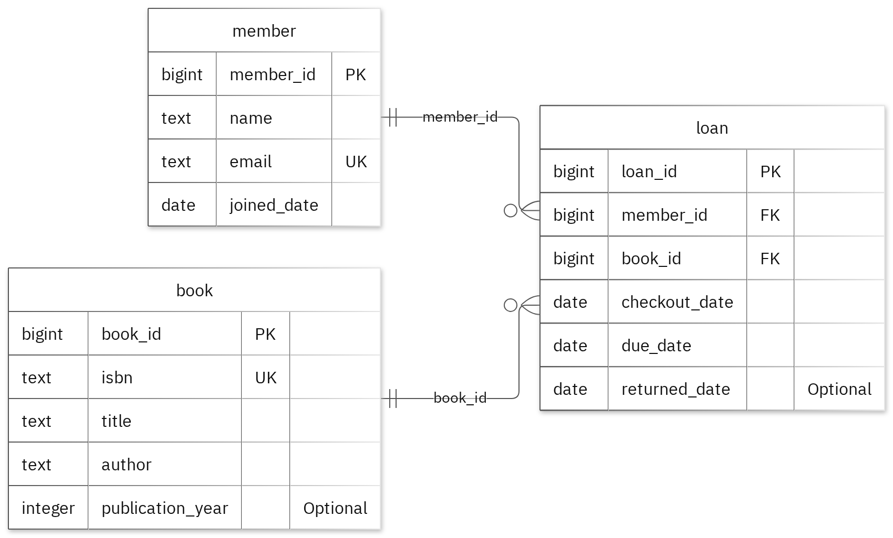

# MIT 8103 Advanced Database Systems

**Library Management System** · Merit Elebor · Student ID 301907071

## Case study

My case study is Library Management System. I designed the database for the library staff managing memberships and the catalogue, also for the library staff recording loans and returns. There are seperate tables named member, book and loan. This supports the operations: register a member and catalogue a book; record a book loan and return; review loan activity by member, book, or date.

## Portfolio 1: Database Design and Modelling

I organised the relational design into 3 tables. Primary keys identify records, foreign keys preserve the links, and checks enforce the stated business rules. Here, a member cannot have two active loans for the same book; enforce uniqueness on member_id and book_id only for rows where returned_date is null. The normalisation examples show the sample data at 1NF, 2NF and 3NF. All 10 deliberately invalid inserts were rejected without changing the valid sample rows.

Figure 1. Tables, keys and relationships. PK: primary key; FK: foreign key; UK: unique value.

<!-- PAGE BREAK -->

## Portfolio 2: Query Processing and Optimisation

ran three SQL queries to test the sample records. The join returned two rows, including Avery Chen (ID: 9780000000001). To compare index performance, I tested against 20,000 separate rows. The execution plan confirmed it used the new index, which dropped the median lookup time from 1.028 ms down to just 0.231 ms. Both test phases returned the exact same records. Keep in mind that these timings are specific to this particular lookup and environment.

## Portfolio 3: Transactions and Concurrency

I used a temporary counter on loan to test COMMIT, ROLLBACK and READ COMMITTED isolation. The uncommitted update remained hidden from the other session, and ROLLBACK restored the earlier committed value. Without locking, two increments left the counter at 2. With SELECT FOR UPDATE, Session B waited for Session A and the final value was 3. The helper is confined to this exercise; the case's original business fields stay unchanged.

## Portfolio 4: NoSQL and Advanced Data Models

I used loan_events for the case's event documents. MongoDB inserted 4 sample events and returned the expected results for 4 queries. Validation rejected an invalid date type and a duplicate event ID. Embedded snapshots keep related details with an event, while the details field can differ by event type. These are fictional events; PostgreSQL continues to enforce its relational rules.

## Repository and evidence

https://github.com/melebor7071-lang/Elebor_Merit_301907071

The portfolio folders contain the SQL and JavaScript, explanations, query plans, result tables and screenshots.

<!-- PAGE BREAK -->

## Portfolio 5: Distributed and Cloud Database Exercise

For this database architecture, I proposed setting up three MongoDB replica members in separate failure zones. This discusses how primary elections work, the role of majority acknowledgment, and how to handle secondary lag, plus the pros and cons of sharding loan_events. I made sure to clarify that while replication keeps the system available, we still need backups for true recovery. PostgreSQL will also need its own availability plan. Just to be clear, this was a theoretical exercise—I didn't actually deploy a live replica set or run any failover tests.

## Individual reflection

I split the data into separate tables for members, books, and loans to avoid repeating the same details across the database. To ensure a member can't check out the exact same book twice at once, I added a unique constraint on the member and book IDs—specifically for rows where the returned date is still null. My tests verify this logic, along with checking required fields and relationships.

The two-session exercise really highlighted a classic race condition: both sessions can read the same starting value before either one finishes its update. Locking the row before reading solves this by making sure both updates are captured. Finally, testing the index reminded me why checking the execution plan is just as important as getting the right answer—two queries can return the exact same data, but one might make the database work a lot harder.

## AI-use declaration

I utilized GitHub Copilot and a portfolio generator to assist in creating the database models, scripts, and explanations, This generator also executed the PostgreSQL and MongoDB exercises, verified the outputs and captured the images of the results. However, I personally reviewed, and checked the work before submission.

## References

- [PostgreSQL: constraints](https://www.postgresql.org/docs/17/ddl-constraints.html)
- [PostgreSQL: EXPLAIN](https://www.postgresql.org/docs/17/using-explain.html)
- [PostgreSQL: isolation](https://www.postgresql.org/docs/17/transaction-iso.html)
- [PostgreSQL: row locks](https://www.postgresql.org/docs/17/explicit-locking.html)
- [MongoDB: data modelling](https://www.mongodb.com/docs/manual/data-modeling/)
- [MongoDB: replication](https://www.mongodb.com/docs/manual/replication/)
- [MongoDB: sharding](https://www.mongodb.com/docs/manual/sharding/)
- [Mermaid: ER diagrams](https://mermaid.js.org/syntax/entityRelationshipDiagram.html)

