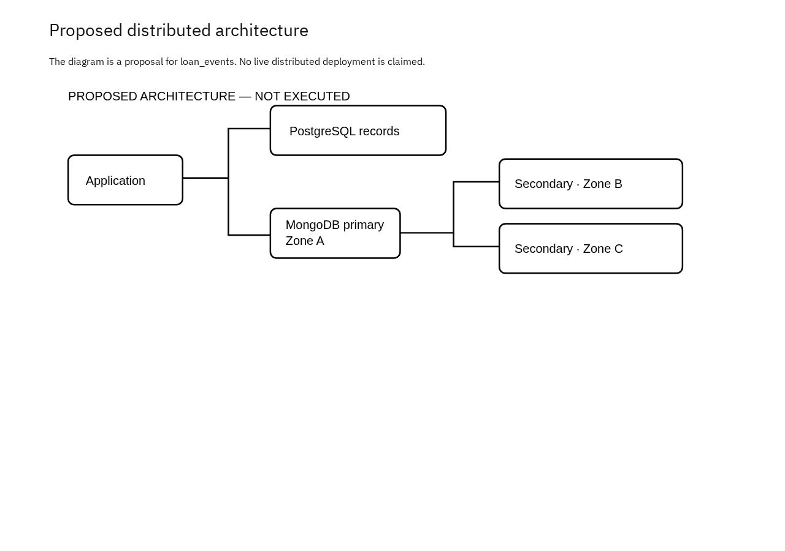

# Library Management System — Portfolio 5

This is the proposed distributed design for the case study.

## Case and proposed deployment

For this Library Management System, PostgreSQL holds our main relational data, while MongoDB tracks loan_events To keep reads fast and straightforward, event documents embed snapshots of member and book data at the time of the event, giving each record immediate lending context. On the deployment side, MongoDB uses a three-member replica set spanning three distinct availability zones in one region. Because PostgreSQL is entirely separate, it needs its own high-availability strategy—setting up a MongoDB replica set won't manage PostgreSQL's failovers.
## Replication and availability

One primary accepts writes. Two secondaries copy the oplog asynchronously. If the primary fails, eligible members can elect a replacement when a voting majority is available. Writes can pause during election. A partition without a majority cannot elect a primary. Three containers on one computer would not protect against loss of that computer.

## Consistency and the case

For loan_events, the proposed client policy uses a majority write concern with a finite timeout, targeting primary reads with a majority read concern whenever committed data is required. Secondary reads are permitted to lag. To prevent duplicate entries during retries, application-level retries require an idempotency key. Meanwhile, PostgreSQL constraints remain the authoritative check for business rules, such as ensuring each email address belongs to at most one member. Note that these settings do not establish atomic transactions across PostgreSQL and MongoDB—handling distributed consistency would require a separate outbox pattern and retrying consumer.

## Sharding trade-off

Sharding distributes documents across nodes to scale out, while replication copies them to maintain high availability. Given the current dataset size in this portfolio, sharding isn't necessary. If loan_events grows significantly, a high-cardinality source identifier evaluated as a hashed shard key would be worth testing against real-world read/write patterns. Choosing a key involves clear trade-offs: a monotonically increasing timestamp key can create write hotspots on a single shard, whereas a hashed key scatters writes evenly but forces time-range queries to hit multiple shards. Any final key selection should be validated against actual data distribution and query execution plans.

## Cloud deployment and recovery

A production-ready deployment would incorporate private networking, strict authentication, least-privilege roles, TLS encryption, real-time monitoring, and validated backups. Note that while replication ensures high availability, it also propagates accidental deletions, meaning it cannot replace dedicated backups. Furthermore, distributing nodes across availability zones guards against localized outages but does not substitute for regional disaster recovery. As this was a theoretical architectural exercise, no cloud infrastructure was provisioned, and no live failover, replication, sharding, or backup recovery tests were conducted.

## References

- [MongoDB: replication](https://www.mongodb.com/docs/manual/replication/)
- [MongoDB: sharding](https://www.mongodb.com/docs/manual/sharding/)

